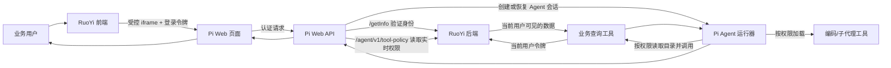
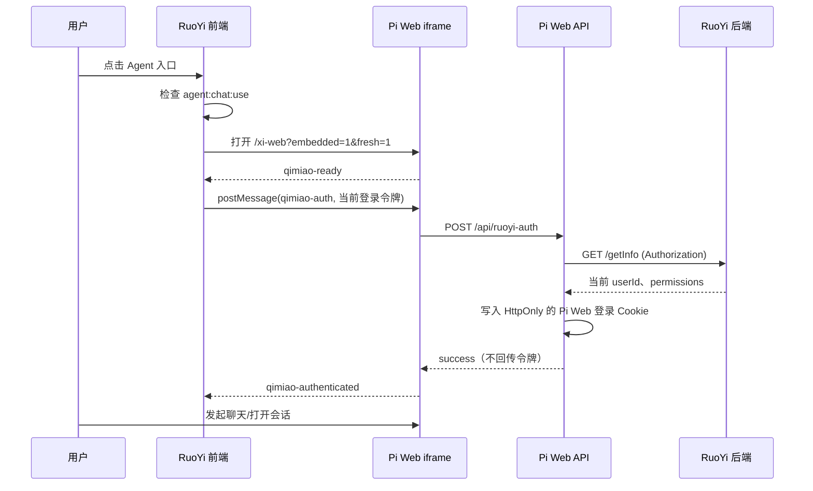
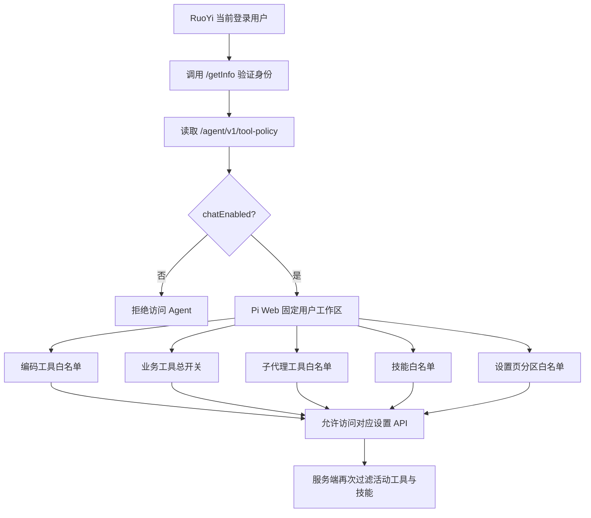
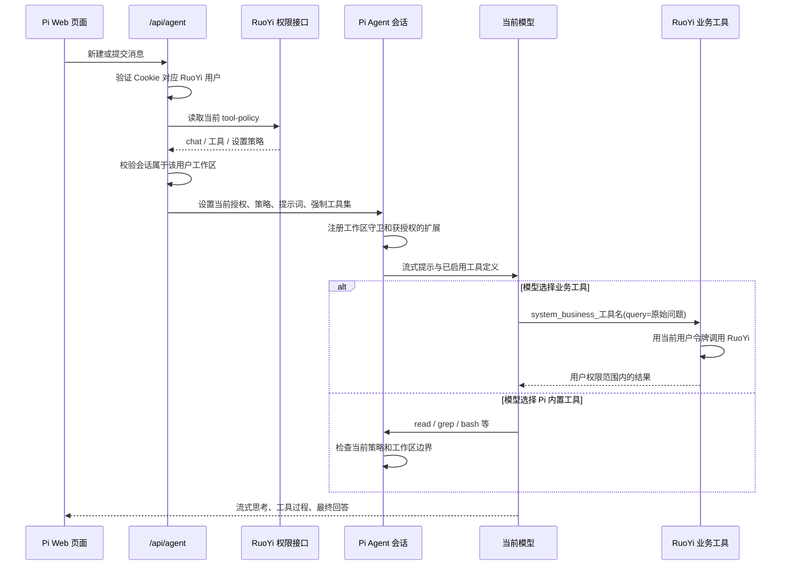

# RuoYi → Pi Web 集成：流程、权限与工具说明

> 适用范围：本文描述当前仓库已经实现的 **RuoYi 受控嵌入模式**。普通独立打开的 Pi Web 不走这套身份、权限和工作区隔离逻辑。
>
> 读者不需要了解 Pi 的内部实现。先看“整体一图”，需要排查时再按后面的步骤和代码索引追溯。

## 1. 一句话说明

RuoYi 是“身份、权限和业务数据”的权威来源；Pi Web 是“聊天界面和 Agent 运行器”。

用户从 RuoYi 打开 Pi Web 时，RuoYi 将登录令牌安全地交给嵌入页。Pi Web 后端用该令牌向 RuoYi 验证用户，并在每次关键操作前重新取得该用户当前权限。只有 RuoYi 已授权的会话、工具、设置和业务数据，才会出现在并可运行于该用户的 Pi Web 会话中。

这不是“前端隐藏按钮”。前端展示会随权限变化，但最终拦截发生在 Pi Web 服务端和 RuoYi 服务端。

## 2. 谁负责什么

| 部分 | 负责的事情 | 不负责的事情 |
| --- | --- | --- |
| RuoYi 前端 | 打开受控对话框、承载 iframe、把当前已登录用户令牌传给 Pi Web、接收拖动/最大化等窗口指令 | 不决定 Pi Web 中最终能调用哪些工具 |
| Pi Web 页面 | 聊天、工具展示、侧边栏、设置页面、数字人面板；只接受受信任父窗口的消息 | 不信任浏览器自行提交的用户 ID 或工具清单 |
| Pi Web API / Agent 运行器 | 验证身份、读取实时权限、创建隔离工作区、限制会话和工具、运行流式会话 | 不替 RuoYi 判断业务数据权限 |
| RuoYi 后端 | 验证登录态、根据当前角色/权限给出 Agent 策略、下发业务工具目录、执行业务查询并限制数据范围 | 不渲染 Pi Web 页面或管理 Pi 的流式会话 |
| 模型 | 根据已注入提示词和当前已启用工具，选择是否/如何调用工具并组织回答 | 不能扩大权限；也不能保证一定选对工具 |

最后一行很重要：**“账户有权限”不等于“模型一定会正确发起一次工具调用”。** 权限决定它能不能做，模型的工具调用能力决定它会不会正确做。模型选择了不存在的工具、参数不符合定义、上游模型服务返回 5xx，都属于模型或服务运行问题，不能据此推断权限没有下发。

## 3. 入口与登录：从点击 RuoYi 到可聊天

### 3.1 时序图

### 3.2 关键细节

1. RuoYi 前端先检查 `agent:chat:use`，没有入口权限时不打开 Agent。
2. iframe 地址会带 `embedded=1&fresh=1`。`fresh=1` 用于避免沿用 URL 上的旧会话；它本身不是权限控制。
3. Pi Web 只接收 `window.parent` 发来的 `qimiao-auth`，并且来源必须是 `NEXT_PUBLIC_RUOYI_EMBED_ORIGIN` 配置出的受信任 RuoYi 源。父页面同样只接收自己 iframe、且来源精确匹配的消息。
4. 令牌不会被 Pi Web 页面保存到 `localStorage`，认证成功后由 Pi Web API 写成 `HttpOnly` Cookie（名称 `pi_web_ruoyi_token`）。浏览器页面拿不到这个 Cookie 的内容。
5. Pi Web 服务端用令牌请求 RuoYi `/getInfo`，只接受 RuoYi 返回的 `userId`；不会相信浏览器传来的用户 ID。
6. 身份结果在 Pi Web 进程内短暂缓存 5 秒，仅为减少连续请求，不是长期授权缓存。
7. RuoYi 切换登录用户时，外层会关闭嵌入窗口，避免旧账户的页面内存被新账户继续看到。

### 3.3 认证失败会怎样

| 情况 | 结果 |
| --- | --- |
| 未配置 `RUOYI_API_BASE_URL` | RuoYi 受控集成不可用，接口返回配置错误 |
| 没有令牌、令牌过期或 `/getInfo` 非成功 | 返回 401，不创建/恢复受控会话 |
| Pi Web 无法连接 RuoYi 身份服务 | 返回 503，不将旧身份当作有效身份继续使用 |
| 父页面来源不在受信任列表 | iframe 忽略消息，令牌不会送往 API |

## 4. 权限是如何计算和执行的

### 4.1 权限流

RuoYi 后端的 `/agent/v1/tool-policy` 根据当前用户的权限标识计算策略。Pi Web 不接受该接口之外的任意工具名：即使远端错误地返回了陌生工具名称，也会被 Pi Web 的固定白名单丢弃。

策略不是在登录时取一次就永远不变：当前实现会在**新建会话、恢复会话、提交会话请求以及订阅会话事件**等关键阶段重新读取。因此，角色被收回或新增权限后，不依赖用户清浏览器缓存才生效。

### 4.2 RuoYi 权限标识与实际能力

| RuoYi 权限标识 | 下发到 Pi Web 的能力 | 说明 |
| --- | --- | --- |
| `agent:chat:use` | `chatEnabled` | 所有受控会话、工作区与工具接口的第一道门槛 |
| `agent:tool:read` | `read` | 读取受控工作区内文件 |
| `agent:tool:grep` | `grep` | 在受控工作区内文本搜索 |
| `agent:tool:find` | `find` | 在受控工作区内查找文件 |
| `agent:tool:ls` | `ls` | 列出受控工作区内目录内容 |
| `agent:tool:edit` | `edit` | 修改受控工作区内已有文件 |
| `agent:tool:write` | `write` | 在受控工作区内写入文件 |
| `agent:tool:bash` | `bash` | 从受控工作区启动命令；见后文“终端边界” |
| `agent:subagent:start` | `Agent` | 创建子代理 |
| `agent:subagent:result` | `get_subagent_result` | 读取子代理结果 |
| `agent:subagent:steer` | `steer_subagent` | 向子代理继续下达指令 |
| `agent:business:use` | `businessToolsEnabled` | 允许加载“当前用户”可用的 RuoYi 业务查询工具目录 |
| `agent:skill:agent-browser` | `skillNames` 中的 `agent-browser` | 允许加载浏览器自动化技能 |
| `agent:skill:figma` | `skillNames` 中的 `figma` | 允许加载 Figma 设计技能 |
| `agent:skill:find-skills` | `skillNames` 中的 `find-skills` | 允许加载技能发现技能 |
| `agent:skill:frontend-design` | `skillNames` 中的 `frontend-design` | 允许加载前端设计技能 |
| `agent:skill:reverse-engineer-anything` | `skillNames` 中的 `reverse-engineer-anything` | 允许加载逆向分析技能 |
| `agent:settings:general` | `general` | 常规设置，包括业务提示词开关/内容 |
| `agent:settings:models` | `models` | 模型、供应商和模型凭据相关设置 |
| `agent:settings:skills` | `skills` | Skills 设置 |
| `agent:settings:subagents` | `agents` | 子代理设置与配置 |
| `agent:settings:plugins` | `plugins` | 插件设置 |
| `agent:settings:mcp` | `mcp` | MCP 设置 |

`agent:business:use` 是“可以请求业务工具目录”的开关，不代表能查询所有业务数据。每一项业务工具和每一次业务工具执行仍带着当前用户令牌回到 RuoYi，由 RuoYi 决定该用户能看见的工具与数据范围。

### 4.3 为什么前端开关不能越权

在普通 Pi Web 中，用户可在界面选择工具。RuoYi 受控模式中，浏览器提交的工具清单不作为授权依据：

- 新建会话时，Pi Web 服务端以 RuoYi 的 `toolNames` 覆盖浏览器提交值；
- 恢复或继续会话时，服务端再次加载策略；若已运行会话中的编码工具或实际载入的技能与当前策略不一致，会在会话空闲时以当前策略重建；
- 浏览器尝试 `set_tools` 会被拒绝，提示“Agent 工具由系统权限统一管理”；
- 会话历史中曾保存的旧工具选择也不能反向恢复已撤销的权限。

## 5. 用户、会话、工作区如何隔离

### 5.1 三层隔离

| 对象 | 隔离方式 | 目的 |
| --- | --- | --- |
| 用户身份 | RuoYi `/getInfo` 验证，令牌仅服务端使用 | 不能伪造用户 ID，也不将登录令牌暴露给页面脚本 |
| 工作区 | 每个 RuoYi 用户固定到项目根目录下独立的 `pi-cwd-<净化用户ID>-<摘要>` 路径 | 文件类工具不会默认落到开发者自己的项目或其他用户目录 |
| 会话与侧栏状态 | 会话访问要验证会话 `cwd` 与当前用户工作区完全一致；侧栏状态按用户摘要单独保存 | 不能用猜到的会话 ID 访问别人的会话或侧栏状态 |

会话 ID 不属于当前用户时，接口刻意返回 **404** 而非 403。这样不会把“这个会话存在，但属于别人”的信息泄露给请求方。

### 5.2 受控会话不加载的本地内容

为避免工作站上已有的本地定制悄悄影响企业会话，RuoYi 受控会话会关闭：

- 本地/项目 `AGENTS.md` 等上下文文件；
- 未被 RuoYi `skillNames` 明确授权的本地 Skills；
- 提示词模板和主题；
- 用户安装的扩展；
- 内置 MCP、Code mode、tool-search。

这意味着 RuoYi 受控会话的能力来源应当清晰可追溯：RuoYi 授权的 Pi 内置工具、已审核且按 `agent:skill:*` 授权的本地技能、RuoYi 返回的业务工具，以及当前用户可用的子代理工具。技能内容文件仅可由已授权技能的 `SKILL.md` 读取，不能借文件读取工具访问工作区外的任意路径；它并不等于“把本机 Pi Web 所有扩展套进 iframe”。

## 6. 一次聊天请求的完整流程

可以把它理解为四道门：

1. **身份门**：是不是已验证的 RuoYi 用户；
2. **入口门**：有没有 `agent:chat:use`；
3. **能力门**：当前角色此刻有哪些工具/设置能力；
4. **资源门**：文件只能在自己的工作区，业务数据只能由 RuoYi 用当前令牌返回。

## 7. 工具体系：哪些工具从哪里来

### 7.1 Pi 内置编码工具

RuoYi 可以下发的编码工具只有 `read`、`bash`、`edit`、`write`、`grep`、`find`、`ls` 七个。其他任意名字不会因远端配置、浏览器参数或历史会话而被启用。

这些工具先经过 RuoYi 策略控制，再经过 Pi Web 的工作区守卫：

- `read`、`grep`、`find`、`ls`、`edit`、`write` 会检查路径必须位于当前用户的固定工作区；
- 带 `..` 的路径、指向工作区外的符号链接、工作区外父目录的写入都会被拒绝；
- Git 状态、Git diff、文件浏览等相关 Pi Web API 也要求对应的 `read` 权限；
- `bash` 以用户工作区作为运行目录，但 shell 命令可以表达复杂路径和网络/进程行为，不能靠文本解析完整证明其只操作某个目录。因此是否授予 `agent:tool:bash` 应视为高风险权限，并由部署环境的操作系统账号、容器和网络策略继续约束。

> 注意：`read` 是文件读取工具，不会自动把 `.xlsx` 解析成 Excel 单元格内容。若要处理 Excel，模型需要一个经过授权且受控的解析途径（例如授予 `bash` 后使用部署方允许的解析程序，或提供专门的只读业务/文件解析工具）。

### 7.2 RuoYi 业务工具

业务工具的加载和执行分成两步：

具体规则：

- 业务工具在模型侧的名称固定加 `system_business_` 前缀，避免与 Pi 内置工具冲突；
- 目录中的原始名称必须符合受限格式，重复、缺描述或异常项目不会注册；
- 模型传入的 `query` 是用户原始问题，最多 500 个字符；
- Pi Web 调目录和执行接口都使用当前已验证用户的 `Authorization`，不使用服务账号降级；
- RuoYi 接口故障、认证失败或目录异常时，Pi Web 不注册任何业务工具，宁可少能力也不串用户；
- 返回 `formattedContent` 时，Pi Web 明确要求模型优先按已校验的中文业务名称、数值和统计范围回答，避免展示 JSON、内部字段或原始分隔符。

### 7.3 子代理工具

子代理能力同样由三项精确权限拆开：启动（`Agent`）、读取结果（`get_subagent_result`）、继续引导（`steer_subagent`）。一个用户即使能聊天，也不必然能够创建或控制子代理。

### 7.4 在受控会话中明确关闭的能力

| 能力 | RuoYi 受控会话中的状态 | 原因 |
| --- | --- | --- |
| 本地用户扩展 / 项目扩展 | 不加载 | 防止工作站环境把未审计能力带入企业会话 |
| MCP | 运行时关闭 | RuoYi 受控工具范围之外，不应通过 MCP 旁路扩权 |
| Code mode | 运行时关闭 | 不让脚本编排绕过受控工具范围 |
| tool-search | 运行时关闭 | 不让模型动态发现未授权工具 |
| 未经 `agent:skill:*` 授权的本地 Skills | 不加载 | 不能由设置页开关或本机安装绕过角色权限 |
| 浏览器自由切换工具 | 服务端拒绝 | 当前工具集必须以 RuoYi 实时策略为准 |

设置页能否打开 MCP、插件等“设置分区”，与当前 RuoYi 受控 Agent 会话是否加载该能力是两件事。设置权限只控制相应设置 API 的访问；受控会话的运行时禁用规则仍然生效。

## 8. 提示词：默认业务模式与可配置开关

### 8.1 当前行为

受控会话默认使用 `RUOYI_BUSINESS_SYSTEM_PROMPT`。它的目标是把 Agent 约束为中文、只读、以业务工具结果为唯一业务数据依据，并禁止把“我来查询”当作没有工具结果时的最终答复。

“设置 → 常规 → 业务提示词”提供两种模式：

| 开关状态 | 会话使用的系统提示词 | 不会改变的内容 |
| --- | --- | --- |
| 开 | 用户保存的自定义业务提示词；初始值为内置业务提示词 | RuoYi 身份、实时权限、工作区隔离、工具白名单、业务接口按用户鉴权 |
| 关 | Pi Web 默认系统提示词 | 同上，关闭只改变提示词，不会扩大工具权限 |

这个配置按 RuoYi 用户分别保存到 Pi 的 Agent 配置目录中，并以用户 ID 摘要命名；不会写进项目工作区，也不会在不同 RuoYi 用户之间共享。只有拥有 `agent:settings:general` 的用户能读取或修改该配置。

### 8.2 一个容易混淆的点

默认业务提示词要求“只读业务查询、不要执行命令”。即使管理员账户被授予了 `bash`、`write` 等工具，模型通常也会按该提示词倾向于不用它们。这是**行为指引**，不是权限缺失。

关闭业务提示词后，模型会回到 Pi Web 默认提示词，但它仍只能看到当前策略允许的工具；不会因为提示词变成默认值而得到未授权的文件、命令、MCP 或跨用户数据能力。

## 9. 设置权限与 API 权限

Pi Web 的设置接口在 RuoYi 模式下会先检查对应设置分区。常见对应关系如下：

| 设置界面 | 所需策略分区 | RuoYi 权限 |
| --- | --- | --- |
| 常规、工具设置、业务提示词 | `general` | `agent:settings:general` |
| 模型、供应商登录/API Key | `models` | `agent:settings:models` |
| Skills | `skills` | `agent:settings:skills` |
| 子代理设置/档案 | `agents` | `agent:settings:subagents` |
| 插件 | `plugins` | `agent:settings:plugins` |
| MCP 配置、测试、登录 | `mcp` | `agent:settings:mcp` |

这是一层接口保护，不只是菜单是否显示。没有分区权限时，直接访问相关 API 也会被拒绝。

## 10. 数字人和外层窗口控制

### 10.1 数字人

数字人是 Pi Web 内的右侧面板，RuoYi 外层旧数字人实现当前被固定关闭。这样可以避免“iframe 内一个数字人、外层又一个数字人”以及右侧留白的问题。

- 面板设置通过 Pi Web `/api/ruoyi-digital-human` 读取；服务端带当前用户令牌向 RuoYi 查询用户 UI 配置；
- 数字人视频/形象与语音播报由 Pi Web 面板控制；
- 字幕只应使用最终回答文本。工具调用、思考过程和内部结构不会作为播报内容；
- 语音与字幕需要按流式文本分句推进，视觉背景应随实际字幕开始/结束显示，而不是在整段结果一到就提前完整出现。

最后一条是当前界面验收原则，不是权限边界：它影响体验，不改变模型响应或业务查询结果。

### 10.2 拖动与双击最大化

RuoYi 的弹窗在 iframe 外，Pi Web 不能直接调用外层窗口 API。因此通过受信任的 `postMessage` 协作：

| Pi Web 事件 | 发给外层的消息 | 外层动作 |
| --- | --- | --- |
| 顶部工具栏拖动超过小阈值 | `qimiao-dialog-drag-start` / `move` / `end` | 移动 RuoYi 对话框 |
| 双击顶部工具栏 | `qimiao-dialog-toggle-fullscreen` | 切换整个 RuoYi 弹窗最大化，而非仅内容区全屏 |
| 数字人按钮操作 | `qimiao-digital-human-action` | 由外层处理对应协作动作 |

Pi Web 会把左侧 Web Agent 标题栏、中间聊天工具栏、数字人标题栏视为可拖动/双击的顶栏区域；点击按钮本身保留原有点击行为，只有指针移动超过阈值才进入拖动。

## 11. 常见现象与定位顺序

| 现象 | 更可能的原因 | 应先检查什么 |
| --- | --- | --- |
| 进入 iframe 后没有可聊天页面 | `agent:chat:use` 不存在，认证失败，或 RuoYi 服务不可达 | RuoYi 前端权限、`/getInfo`、`/agent/v1/tool-policy` 响应 |
| 以前有的工具突然没了 | 当前角色策略已变化，或业务工具目录请求失败 | 当前用户的 `/agent/v1/tool-policy`；再看业务工具目录日志 |
| 能看到会话标题但打开返回不存在 | 会话不属于当前用户工作区 | 不要改成 403；404 是防会话枚举的预期设计 |
| 模型调用 `general-purpose` 等不存在工具 | 模型没有按当前工具定义调用 | 查看“工具定义”和模型原始 tool call；这不是权限自动下发的工具 |
| 模型只做业务查询，不用文件/命令工具 | 默认业务提示词要求只读业务查询，或模型本身倾向保守 | 先确认工具是否实际在当前策略中；再判断是否应关闭/调整业务提示词 |
| `.xlsx` 预览失败或读不出单元格 | 浏览器预览能力/文件格式限制，`read` 不等于 Excel 解析器 | 查看预览接口、是否有安全的解析工具；不要把下载/预览错误误判为 RuoYi 业务权限 |
| 业务查询没有数据 | RuoYi 业务工具没有匹配、当前用户无数据权限，或业务接口返回不足 | 以工具实际返回的状态、权限要求和数据范围为准 |
| 出现 502、模型中途断流 | 模型供应商或推理服务异常 | 看模型服务与 SSE/接口错误，不要先修改工具权限 |
| 外层拖动或双击失效 | 父/子页面 origin 不一致（常见 `localhost` 与 `127.0.0.1` 混用），或外层没有接收消息 | 对齐 iframe URL 与 `NEXT_PUBLIC_RUOYI_EMBED_ORIGIN`，检查 `postMessage` 控制台警告 |

## 12. 给维护者的变更原则

若后续新增 RuoYi 能力，建议按下面的顺序设计，而不是只在前端加一个按钮：

1. **在 RuoYi 后端定义权限标识和实际业务数据边界**；
2. **通过 `tool-policy` 或业务工具目录把当前用户的可用能力下发给 Pi Web**；
3. **在 Pi Web 只接受预定义白名单，不接受任意远端工具名**；
4. **在 API 层重新验证身份、策略、会话/工作区归属**；
5. **在 Agent 运行时再次限制活动工具，不能只依赖前端隐藏**；
6. **为失败做“拒绝而不降级”处理**：认证或权限服务异常时，不使用系统账号、旧令牌或全局默认权限；
7. **最后才补界面展示和提示词说明**。

不要为了临时可用而把用户传入的 `toolNames` 直接信任、将 RuoYi 用户令牌交给浏览器脚本、允许会话跨工作区恢复，或用“隐藏菜单”代替 API/运行时检查。这些都会绕过本文件前面描述的安全边界。

## 13. 代码地图

| 关注点 | Pi Web 文件 | RuoYi 文件 |
| --- | --- | --- |
| iframe 启动、令牌投递、窗口拖动/最大化 | `components/AppShell.tsx`、`lib/ruoyi-embed-origins.ts` | `artpro-ui/src/components/core/layouts/qimiao-web-launcher/index.vue` |
| 令牌认证与用户工作区 | `app/api/ruoyi-auth/route.ts`、`lib/ruoyi-identity.ts`、`lib/ruoyi-access.ts` | `/getInfo` |
| 实时权限策略 | `lib/ruoyi-tool-policy.ts`、`lib/ruoyi-session-access.ts` | `ruoyi-admin/src/main/java/com/ruoyi/web/controller/system/SysPiWebAgentPolicyController.java`、`PiWebAgentPolicyService.java` |
| 建会话、续会话、事件流 | `app/api/agent/new/route.ts`、`app/api/agent/[id]/route.ts`、`app/api/agent/[id]/events/route.ts`、`lib/rpc-manager.ts` | `/agent/v1/tool-policy` |
| 业务工具 | `lib/ruoyi-business-tools.ts` | `/agent/v1/business-tools`、`/agent/v1/business-tools/execute` |
| 文件与工作区守卫 | `lib/ruoyi-workspace-tool-guard.ts`、`lib/ruoyi-terminal-access.ts` | 无：Pi Web 负责工作区约束，部署环境继续承担 OS/容器约束 |
| 业务提示词设置 | `lib/ruoyi-system-prompt.ts`、`app/api/ruoyi-system-prompt/route.ts`、`components/SettingsPanel.tsx` | 通过 `agent:settings:general` 控制访问 |
| 数字人 | `components/DigitalHumanPanel.tsx`、`app/api/ruoyi-digital-human/route.ts` | 用户 UI 配置接口 |

## 14. 相关文档与验证入口

- [RuoYi 集成部署与界面说明](./ruoyi-integration.md)
- [工具、提示词与受控会话规则](./agents/tools.md)
- [设置界面与权限接入规则](./agents/settings-ui.md)
- `app/api/agent/new-ruoyi-policy.test.mjs`：新建受控会话的策略测试
- `app/api/agent/route-ruoyi-policy.test.mjs`：继续受控会话的策略测试
- `app/api/settings/ruoyi-settings-policy.test.mjs`：受控设置访问与业务提示词测试

本文以当前代码为准。新增权限、工具、接口或运行时开关时，应同步更新本文件中的权限表、流程图和“明确关闭的能力”列表，避免文档把过去的行为误写成现在的安全承诺。
